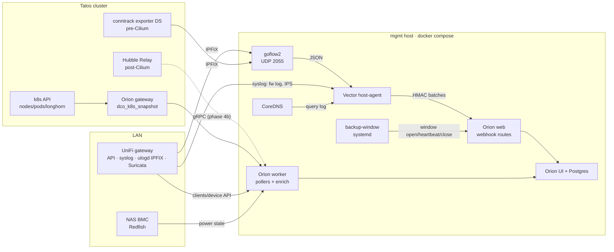

# Design: DCO network & host visibility for Orion

Status: proposal, revision 2 · 2026-11-28 · docs only. Revision 2 fixes the post-merge review of PR #24 and adds the owner's gateway, DNS and IoT decisions.

Goal: Orion answers "what is this device, is it up, why, and who is it talking to?" without
anyone running `talosctl` / `kubectl` / `journalctl` by hand. Names (`mgmt`, `nas`, `node-0N`), addresses (`10.0.0.x`)
and MACs (`xx:xx:…`) are placeholders, not the real install. Figures in the "with this design" column are illustrative.

## 1. Motivating incidents → what Orion must answer

| # | Question asked | What it took by hand | With this design (clicks) |
|---|---|---|---|
| 1 | "Why is the NAS (`nas`, normally off) on?" | Read a systemd timer on `mgmt`: a nightly backup-window unit wakes the NAS by WoL, waits for Longhorn backup jobs, then shuts it down via the NAS API. The first full weekly media backup (~16.7 TB, 3 volumes, one at a time, ~22–26 MB/s over NFS) had been running for 6 days. A `mgmt` reboot killed the waiting service, so nothing was left to shut the NAS down. | Alert **"nas: power window overdue · owner heartbeat lost"** (one escalating event, §9) → **1 click** opens the host page: *Up 6d (BMC: on) · planned window opened by `systemd@mgmt` · expected off: after Longhorn backups · owner heartbeat lost 3d ago (mgmt rebooted) · backup 2 of 3 volumes, 61 %, 24 MB/s, ETA ~3d* (backup line from phase 2). |
| 2 | "Why is MAC `xx:xx:xx:xx:xx:02` uploading?" | ARP lookups to map MAC → node-02, then sampling `/proc/net/dev` via talosctl and decoding the `cni0` bridge FDB to tie traffic to pods. Top talker: Longhorn instance-manager (replica sync, LAN). A torrent client behind a VPN sidecar was small at the time. | MAC search → host page **node-02** (click 1) → Traffic panel (click 2). What the panel can say grows by phase (§5.9): phase 2 *"top pod `longhorn-system/instance-manager` 41 MB/s; node tx 42 MB/s vs. whole-site WAN tx 1 MB/s → ≥ 41 MB/s is LAN"*; phase 3 adds node-level WAN destinations; phase 4a gives per-pod LAN/WAN. |

## 2. What exists today (verified on `main`)

| Piece | Path | Live data source? | Note |
|---|---|---|---|
| Flows API + UI | `apps/web/src/app/api/monitoring/security/flows/route.ts`, `components/security/FlowTable.tsx` | **No.** It proxies the gateway's `elk_flow_search`, and no Elasticsearch is deployed. | It sends `query:'*'` and `limit`, but the tool `JSON.parse`s `query` and reads `size`, so it fails even when ES is present. The table is a flat 5-tuple: no asset, pod or LAN/WAN context. |
| ES/ntopng/Wazuh tools, ntopng poller | `apps/gateway/src/builtin-tools/security.ts`, `apps/web/src/jobs/security-poll-ntopng.ts` | No (none of the three is deployed) | `prometheus_query` needs VictoriaMetrics. The poller reads `NTOPNG_URL`; the gateway tool, `lib/seed-soc-config.ts` and `SecuritySettings.tsx` use `NTOPNG_API`. |
| K8s events poller | `apps/web/src/jobs/security-poll-k8s.ts` | Only when a cluster env has a connected gateway | Calls the narrow `kubectl_get_events` tool every 30 s. This is the pattern to reuse. |
| `kubectl_get` tool | `apps/gateway/src/builtin-tools/kubernetes.ts`, `lib/run.ts` | n/a | Output is cut at 256 KB (`DEFAULT_MAX_OUTPUT`) with a marker; only `wide/json/yaml/name` output. Unusable for inventory JSON (§5.1). |
| Gateway audit | `apps/gateway/src/gateway-audit.ts` (called from `index.ts`) | Yes | **Every** tool call, MCP or REST, posts an `agent.tool.invoked` `gateway_audit` SecurityEvent (unknown tools sev 10, no incident). Pollers add to it. |
| Webhooks | `.../security/webhooks/{falco,crowdsec,wazuh,host-agent}/route.ts` | Falco: **yes**. CrowdSec webhook exists, but the in-cluster CrowdSec is not wired to it | `webhook-auth.ts` has HMAC and a 5-min `X-Timestamp` replay check. The **host-agent route skips the replay check** (Vector can't template the header); it relies on 24 h `dedupKey` idempotency. |
| Host agent | `deploy/host-agent/vector.toml` | Built (Orion host telemetry) | journald, docker events, Vault audit, Traefik. UDM syslog (UDP 5514) arrives but goes **only to Loki**. No heartbeat: the route returns before touching `SourceHealth` on an empty batch, so `host_agent` health moves only when events flow. |
| Source health | `SourceHealth` / `EnvironmentSourceHealth`, `components/security/SourceHealthPanel.tsx`, `.../security/sources/route.ts`, `lib/security/source-health-utils.ts` | Yes | Status is `healthy/stale/down` only. A row never seen is `down`, and `jobs/security-stale-check.ts` emits `source_stale` (sev 40) once an hour per stale row. **No "not configured" state** (§7). |
| Events / incidents | `SecurityEvent`, `Incident`, `CorrelationRule`; `lib/security/rule-engine.ts`, `workers/security-correlator.ts` | Yes | A SecurityEvent shows in the alert feed with ack. It becomes an Incident **only if a CorrelationRule matches** (the correlator posts a security-room notice and wakes Warden at sev ≥ 40; no ntfy/Slack push on creation). Rule types: `threshold`, `pattern`, `malware`, `process`, `composite`, `volume_sum`. `dedupKey` is indexed, not unique. |
| Gateway k8s read RBAC | `apps/web/src/lib/gateway-rbac.ts` | n/a | `view` plus a read ClusterRole covering `nodes` and `longhorn.io` `backups`/`backupvolumes`/`volumes`/`recurringjobs`. Phase 1 needs no RBAC change. |
| Talos tools | `apps/gateway/src/builtin-tools/talos.ts` | n/a | The caller passes a base64 talosconfig **in each tool call**; it is written to a 0600 temp file and passed as `--talosconfig`. The module also has write tools (patch, upgrade, reboot). |
| Monitoring installer | `apps/web/src/lib/bootstrap/monitoring.ts`, `deploy/monitoring/**` | n/a | Imperative `kubectl apply`/`helm`. Applies `ntopng/service.yaml` but **never the DaemonSet**. Its VictoriaMetrics stack values enable node-exporter and kubelet scraping; whether it runs here is open (Q1). |
| Orion CoreDNS | `deploy/docker-compose.yml` (`coredns`), `deploy/coredns/Corefile.example` | Logs to stdout only | Resolver for the trusted main VLAN. The template has `log`; the live Corefile is runtime state (gitignored). |

## 3. Requirements

| ID | Requirement | From | Phase |
|---|---|---|---|
| R1 | Asset inventory: one canonical asset per device (§5.2) ↔ MACs/IPs/hostnames ↔ k8s node ↔ workloads, with history | #2 | 1 |
| R2 | Alert on a new device, or an IP change on a static asset | DCO | 1 |
| R3 | Host up/down, plus power state from the BMC where one exists | #1 | 1 |
| R4 | Planned power windows: owner, reason, expected-off time, owner heartbeat; alerts for overdue, orphaned and unplanned-up | #1 | 1 |
| R5 | Backup-job visibility: Longhorn backup state, progress, rate, ETA, linked to the window that keeps the NAS up | #1 | 2 |
| R6 | Per-pod and per-host byte rates (who is busy), with a LAN lower bound | #2 | 2 |
| R7 | Flow telemetry: src asset/pod → dst asset/name/IP, port, bytes in/out, LAN/WAN/inter-VLAN scope | #2 | 3–4 |
| R8 | DNS visibility, **Orion CoreDNS only** (owner decision): which client resolved what | DCO | 5 |
| R9 | IDS alerts in Orion from the gateway's Suricata (IPS mode) | DCO | 5 |
| R10 | Baseline/anomaly: new WAN destination per asset/workload, upload spike | DCO | 6 |
| R11 | Works on Flannel now and on Cilium/Hubble later, behind one ingestion contract | env | all |
| R12 | Every collector lands in the installer/templates, ships off by default, and shows in Source Health as *not configured* until set up | owner rule | all |
| R13 | IoT VLAN (internet-only by intent): alert on IoT→LAN/inter-VLAN attempts and breaches; per-device WAN destinations/volume | owner | 5–6 |

## 4. Architecture



All flow sources are normalised into one `FlowBatch` (5-tuple, bytes/packets each way, exporter, observation window).
Enrichment (asset, pod, scope) happens once, in the web route or a worker job reading a staging table, so swapping the conntrack
exporter for Hubble changes no storage or UI.

## 5. Data sources: options and recommendations

### 5.1 Inventory (R1, R2) and the k8s data path
| Option | Gives | Cost | Verdict |
|---|---|---|---|
| UniFi Network API (clients, devices) | MAC, IP, hostname, OUI, VLAN, last seen, uplink, per-client tx/rx, gateway WAN counters | Read-only local account | **Primary** for L2/L3 |
| New narrow gateway tool `dco_k8s_snapshot` | Nodes (name, InternalIP, Ready), pods (uid, ns, name, owner, node, podIP(s), hostNetwork), Longhorn backups (state, progress, volume, size), Longhorn volumes (name, size, actualSize, recurring-job labels) and recurringjobs | Gateway change (owner path, own PR) | **Primary** for the node/pod layer |
| ARP/neighbour table from `mgmt` (Vector `exec` of `ip -j neigh`) | MAC ↔ IP on the mgmt VLAN | Tiny | Fallback when UniFi is unreachable |
| Talos API (`LinkStatus`) | Per-NIC MAC on nodes | Separate read-only tool with an `os:reader` config (owner path) | Later; helps merge multi-NIC nodes |

Why not `kubectl_get`: `-o json` for ~150 pods is 2–3 MB and `run.ts` cuts returned output at 256 KB, so the worker would get partial, unparsable JSON. `dco_k8s_snapshot` runs fixed,
argument-free `kubectl get` calls (API paging via `--chunk-size=250`, `-o custom-columns` projections, ~150 B/pod) and returns `{nodes, pods, longhorn:{ok, error?, items}}` with
`maxOutput: 0` (still bounded by the 16 MB `maxBuffer`, failing loudly, never truncating); each kind feeds its own health row, and the poller writes the env row on its first attempt, so
an unknown tool shows as down ("gateway too old"). One call/min for all three kinds adds ~1.4 k `gateway_audit` events/day/env (sev 10; the k8s events poller adds ~2.9 k). Rejected: an
in-cluster poller with its own ServiceAccount pushing to Orion (new workload, token, ingress; revisit above ~5 k pods) and kube credentials in the worker (breaks the gateway boundary).

### 5.2 Asset identity (R1)
Canonical key `Asset.key`, first match wins: `manual:<slug>` (operator pin) → `k8s:<envId>/<nodeName>` → `bmc:<serial>` → `vip:<ip>` (listed in `SecurityConfig`) → `mac:<mac>`. IPs and
hostnames are never identity; they are time-bounded `AssetAddress` rows (`firstSeen`, `lastSeen`, `validTo`). The key is assigned once at creation and never re-derived.
Higher-precedence identities found later attach to the existing asset as `AssetAddress` alias rows (kind `k8s_node|bmc_serial`), and a match on any alias resolves to the asset. The BMC
NIC's MAC is an `AssetAddress` (source `bmc`) of the host asset.

| Case | Handling |
|---|---|
| MAC randomisation (locally-administered bit set) | Keyed by MAC but flagged `macRandomised`. Phones keep one private MAC per SSID, so most stay stable. A new random MAC whose DHCP hostname/client-id matches a known asset becomes a **merge suggestion**, never an auto-merge. `dco.asset.new` drops to sev 20 for random MACs on guest/IoT VLANs |
| DHCP churn | When an IP moves to another MAC, the old binding gets `validTo`. Flows are attributed to the binding valid at flow time, so no `ip_changed` fires for dynamic assets |
| Multi-NIC hosts | One asset, several MAC rows. Auto-merged when the k8s node addresses or Talos `LinkStatus` (later) list both NICs; otherwise a manual merge in the UI. A merged asset keeps a `mergedIntoId` redirect |
| VIPs (kube-vip, MetalLB, keepalived) | `vip:<ip>` asset. The holding MAC changes are recorded ("held by node-0N"), never alerted as `new`/`ip_changed` |
| Pod IP reuse | `WorkloadAddress` keyed by pod UID with `validFrom`/`validTo` from the 60 s snapshot. Pods shorter than one poll, or overlapping rows, fall back to the node asset with `workload=unknown`. hostNetwork pods are attributed to the node |

### 5.3 Power and up state (R3, R4)
| Option | Gives | Verdict |
|---|---|---|
| TCP-connect probe from the worker (e.g. :443/:22). No raw ICMP, so no `NET_RAW` | Reachable / unreachable | **Primary** for assets with `probe.tcpPort` set |
| k8s Node `Ready` (from the snapshot) | Node health | **Primary** for nodes |
| BMC Redfish (`/redfish/v1/Systems/*` `PowerState`) | On/off even when the OS is hung | **Yes for the NAS.** Separates *off* from *hung* |
| `mgmt` reboot | The worker records boot-id/uptime at start; a change emits `dco.host.rebooted` (sev 30) | Off-host liveness of `mgmt` needs an external prober (out of scope) |
| Window reporter: the systemd unit `curl`s Orion on open, every 5 min, and on close (~10 lines in the homelab repo, not Orion; token from a file via `curl -H @/run/credentials/...`, never argv) | **Why it is up**, owner, expected-off | **Required.** Turns "up" into "up on purpose". Orion, not the unit, remembers an open window, so a reboot yields an *orphaned window* alert instead of silence |

### 5.4 In-cluster flows and pod attribution (R6, R7)
| Option | Pros | Cons | Verdict |
|---|---|---|---|
| A. cAdvisor pod network counters via VictoriaMetrics (`container_network_*_bytes_total`) | No new collector; per-pod bytes | No destinations; needs VM deployed | **Phase 2.** Answers "which pod is busy" |
| B. conntrack exporter DaemonSet (hostNetwork, `CAP_NET_ADMIN`, read-only rootfs). Prefer off-the-shelf `ulogd2` NFCT → IPFIX (same stack as the gateway, §5.5); fallback a ~200-line Go agent | Sees the pod IP **before** Flannel SNAT, both directions, LAN and WAN. Uses the same goflow2 collector | Needs `net.netfilter.nf_conntrack_acct=1` (Talos machine-config patch via Git); long-lived flows need periodic delta export | **Recommended pre-Cilium** |
| C. eBPF agent (e.g. Microsoft Retina, CNI-agnostic) | Packaged, pod-aware | Privileged and heavier; Talos support unverified | Fallback if B fails on Talos |
| D. Hubble (post-Cilium) via Relay gRPC | Native identity, drops, L7 | Needs Cilium; Relay mTLS | **Recommended after Cilium.** Replaces B. With kube-proxy replacement, netfilter conntrack misses pod traffic, so B must go |

### 5.5 Network-edge flows and IDS (R7, R9): UniFi Dream Machine Pro (answered 2026-11-28: no NetFlow toggle)
Verified: UniFi OS 6.x / Network 11.x has **no NetFlow/IPFIX toggle**. The box ships `ulogd2` with the NFCT input and IPFIX
output plugins, and UniFi already runs its own NFCT stack. Suricata 8 runs on it in IPS mode.

| Piece | Design |
|---|---|
| Edge flows | A **second, separate** ulogd instance with its own config under the persistent data partition (e.g. `/data/orion-dco/ulogd-ipfix.conf`): NFCT → IPFIX to goflow2 on `mgmt` (UDP 2055). It never edits `/etc/ulogd.conf` or UniFi's own stack. NFCT's periodic dump (`pollinterval`) gives interim counters for long flows; the worker computes deltas per conntrack entry. Verify on the box: plugin chain, goflow2 decoding of ulogd's IPFIX template, `nf_conntrack_acct`, CPU |
| What it sees | Every routed flow: WAN and inter-VLAN, for all devices (NAS, IoT, nodes). Pods appear as their node IP (Flannel SNAT). Same-L2 traffic (e.g. Longhorn sync) does not cross the gateway |
| Re-apply | Firmware updates likely overwrite `/etc` and may drop boot hooks. An idempotent `apply/status/remove` script kept under `/data`, run by an on-boot hook there. Drift detection: the `flows_edge` source goes stale → `source_stale`; runbook: re-run `apply` |
| Approval | **Gateway modification outside UniFi support; needs explicit owner approval** and is applied by the owner over SSH. `remove` is the rollback |
| IDS | Suricata alerts via UniFi's remote syslog (already reaching Vector on 5514) → extend the existing `udm_to_event` transform (it already tags `ids.alert`/`firewall.drop` but sinks only to Loki) and route `ids.*` and only those `firewall.drop` lines whose source is in a `dco.vlans` IoT CIDR (or that carry the IoT isolation rule's log prefix) to the DCO route; other drops stay Loki-only. Verify the lines carry signature id, src/dst and action; fallback is shipping Suricata `eve.json` alerts, a further gateway modification under the same approval |
| ntopng / mirror port | ntopng stays an optional integration (installer gap, env-var mismatch, single-node view). Zeek/Suricata on a SPAN port: deferred, phase 7 |

### 5.6 DNS (R8): Orion CoreDNS only (owner decision 2026-11-28)
Gateway dnsmasq and cluster CoreDNS are **out of scope**. A new Vector `docker_logs` source, `include_labels = ["com.docker.compose.service=coredns"]`: `log` gives client, qname, qtype,
rcode; answers need opt-in CoreDNS `dnstap` → Vector `dnstap`. Not the existing source (labels are ANDed). IoT/guest flows show IP and /24, plus a name only if a main-VLAN client resolved it.

### 5.7 IoT VLAN (R13)
IoT CIDRs come from `SecurityConfig` (`dco.vlans`: name, cidr, trust `trusted|iot|guest`, `allow` [`cidr:port`] owner-approved exceptions). Excluded everywhere: the gateway's own
IoT-VLAN address for DNS/DHCP/NTP, multicast and broadcast.

| Need | Source | Alert (§9) |
|---|---|---|
| Blocked attempts IoT → LAN / other VLAN | UDM firewall log via syslog. Blocked NEW packets never reach NFCT, so the owner must enable logging on the IoT isolation rule | `dco.iot.isolation_attempt` |
| Breach: an **allowed** IoT → LAN flow | Edge NFCT flows (§5.5) | `dco.iot.isolation_breach` |
| Per-device WAN destinations and volume | Edge flows → `FlowRollup` + `AssetPeer` | `dco.flow.new_destination` (IoT sev 40) |
| IDS | Gateway Suricata | `ids.*` |

### 5.8 Backups (R5)
`dco_k8s_snapshot` includes `backups.longhorn.io` (`status.state`, `progress`, `volumeName`, `size`, `backupCreatedAt`, `messages`), Longhorn volumes (name, size, actualSize,
recurring-job labels) and recurringjobs (`gateway-rbac.ts` already grants both). The worker derives rate and ETA from successive progress samples. A backup whose target is the NAS is
linked to the open window, so the window's expected-off becomes "when the last linked backup completes".

### 5.9 Incident #2's LAN/WAN answer, by phase
| After | Sources | Can answer | Cannot answer |
|---|---|---|---|
| 1 | UniFi clients + snapshot | MAC → node-02; node busy (UniFi port counters, LAN+WAN mixed) | Which pod; LAN vs WAN |
| 2 (2b) | node-exporter NIC counters, cAdvisor pod counters, UniFi gateway WAN tx | Top pods; **LAN lower bound** = node tx − whole-site WAN tx. Credible whenever WAN is quiet, as in the incident | The split when WAN is busy; destinations |
| 3 (3c) | UDM edge flows | Per-node and per-host WAN bytes and destinations; LAN = node tx − node WAN tx; inter-VLAN flows | Per-pod split (SNAT); same-L2 peers |
| 4a | Node conntrack | Per-pod LAN/WAN and destinations | – |

## 6. Flow storage

Volume estimate for about 60 active LAN assets and ~150 pods; raw records (0.5–3 M/day, 150–600 MB) are not stored. The VPN sidecar hides the torrent swarm behind one endpoint.

| Layer | Rows/day | Size/day | Retention | Size at retention |
|---|---|---|---|---|
| 5-min rollup (asset/workload × dst × port × proto × scope), top 50 dsts per src per bucket, rest folded into `other` | ~60–180 k | ~15–40 MB | 30 d | ~0.5–1.2 GB |
| 1-hour rollup | ~10–20 k | ~3 MB | 365 d | ~1 GB |
| `AssetPeer` baseline (first/last seen per peer) | grows slowly | <1 MB | 180 d idle | <100 MB |

Never sum across exporters: node/host WAN totals come from `flows_edge`, per-pod rows from `flows_cluster`; the UI labels the source.

Store: **Postgres (existing `pgvector/pgvector:pg16`), rollups only**: no new service, backup or installer piece; Prisma, joins with `Asset`, retention via `security-retention-daily`; not
for raw forensics. Rejected: ClickHouse (new stateful service, ~1 GB RAM; escape hatch for raw forensics, Q5) and Elasticsearch (2–4 GB heap, not deployed; tool kept for existing ES).

Adapting existing code: the flows route gets a `FlowBackend` interface: `postgres` (default) reads `FlowRollup`; `elk` keeps
today's gateway call with the `query`/`size` mismatch fixed. The response keeps `src_ip`/`dst_ip`/... and adds `src_asset`,
`src_workload`, `dst_name`, `scope`, `bytes_out`/`bytes_in` (`src_port` null, `timestamp` = `bucketStart`, `duration` = `bucketSec`; the folded
row uses `dstIp` "0.0.0.0", `dstPort` 0, `dstName` "other"); `FlowTable` renders new columns only when present. Read-only agent
tools `dco_flows`, `dco_asset_lookup`, `dco_host_status` (phase 7) query the web API. `elk_flow_search` stays as it is.

## 7. Data model additions (Prisma sketch)

```prisma
model Asset {             // one per physical/virtual device
  id String @id @default(uuid()); key String @unique  // canonical identity, §5.2
  environmentId String?; kind String // host|k8s_node|nas|network|iot|vip|unknown; env set for k8s nodes
  name String; primaryMac String?; macRandomised Boolean @default(false) // MAC is display only
  primaryIp String?; vendor String?; vlan String?; tags String[]; k8sNodeName String? // vendor = OUI, tags e.g. static
  expectedPower String @default("unknown") // always_on|scheduled|on_demand|unknown; only always_on raises host.down; k8s_node and vip assets are created always_on; others default unknown
  known Boolean @default(false)              // set on the Inventory/host page only; acking an alert never sets it
  state String @default("unknown"); powerState String?; stateSince DateTime? // up|down|unknown; BMC on|off
  muteUntil DateTime?; mergedIntoId String?  // maintenance mute; redirect after a merge
  probe Json?             // {tcpPort, bmcRef}: refs only, creds stay in Vault
  firstSeen DateTime @default(now()); lastSeen DateTime?
  @@index([primaryIp])
}
model AssetAddress {      // MAC/IP/hostname bindings, time-bounded
  id String @id @default(uuid()); assetId String; kind String // mac|ipv4|ipv6|hostname|k8s_node|bmc_serial
  value String; source String; firstSeen DateTime; lastSeen DateTime; validTo DateTime?
  @@index([kind, value, validTo]) // + partial unique (kind,value) WHERE validTo IS NULL, raw SQL in the migration
}
model WorkloadAddress {   // pod IP → workload, time-bounded for attribution
  id String @id @default(uuid()); environmentId String; podUid String; ip String
  namespace String; pod String; ownerKind String?; ownerName String?
  nodeAssetId String?; hostNetwork Boolean; validFrom DateTime; validTo DateTime?
  @@unique([environmentId, podUid, ip]) @@index([ip, validFrom])
}
model AssetStateChange { id String @id @default(uuid()); assetId String; from String; to String; at DateTime; source String; reason String? }
model PowerWindow {       // the plan
  id String @id @default(uuid()); assetId String; name String
  ownerRef String         // e.g. "systemd:backup-window@mgmt"
  maxDurationMin Int; graceMin Int @default(30); heartbeatEveryMin Int @default(5)
  linkBackups Boolean @default(false)
}
model PowerWindowRun {    // one occurrence
  id String @id @default(uuid()); windowId String; openedAt DateTime
  expectedOffAt DateTime?; lastHeartbeatAt DateTime?; closedAt DateTime?
  status String           // open|closed|overdue|orphaned|unplanned
  detail Json?            // linked backup names, close reason
}
model BackupJob {         // mirror of Longhorn Backup CRs
  id String @id @default(uuid()); environmentId String; name String; volume String
  state String; progress Int; sizeBytes BigInt?; rateBps BigInt?; etaAt DateTime?
  startedAt DateTime?; completedAt DateTime?; updatedAt DateTime @updatedAt
  @@unique([environmentId, name])
}
model FlowRollup {
  bucketStart DateTime; bucketSec Int        // 300 | 3600
  srcAssetId String?; srcWorkload String?    // "ns/owner"
  srcIp String; dstIp String; dstAssetId String?; dstName String?
  dstPort Int; proto String; scope String    // lan|wan|cluster|intervlan
  bytesOut BigInt; bytesIn BigInt; packets BigInt; flows Int; exporter String
  @@id([bucketStart, bucketSec, srcIp, dstIp, dstPort, proto, exporter])
  @@index([srcAssetId, bucketStart]) @@index([scope, bucketStart])
}
model AssetPeer { subject String; peer String; port Int; firstSeen DateTime; lastSeen DateTime; bytes BigInt; @@id([subject, peer, port]) }
model FlowBatchSeen { batchId String @id; receivedAt DateTime } // replay dedup, pruned after 24 h by security-retention-daily
model DnsObservation { clientIp String; qname String; answer String @default(""); firstSeen DateTime; lastSeen DateTime; count Int; @@id([clientIp, qname, answer]) } // answer needs dnstap
```
Each schema slice ships its own `tYYYYMMDDHHMMSS_<name>` migration and regenerates `context/schema.md`. LAN CIDRs (RFC 1918 plus the pod/service
CIDRs), `dco.vlans`, `dco.peerAllow` and known VPN endpoints live in `SecurityConfig` and drive `scope`.

**Not-configured state (no schema change).** A code catalog lists the DCO sources: global `unifi`, `power_probe`, `bmc`, `flows_edge`, `dns`, `udm_ids`, `udm_fw`; per-env
`k8s_inventory`, `longhorn_backups`, `flows_cluster`, `hubble`. (1) An unconfigured source writes **no** health row, so `security-stale-check` never sees it. (2) The sources route
returns catalog entries without a row as `status: 'not_configured'` (fourth value beside `healthy/stale/down`); the panel shows them grey, outside the counts, linking to settings.
Per-env DCO sources are returned per (`environmentId`, source), not collapsed per name as today; `not_configured` is decided per env; the panel groups per-env rows by environment. (3)
Saving settings creates the row with `lastSeenAt = now` (one `staleAfterMs` of grace). (4) Disabling deletes the row. (5) Liveness is separate from alerts. Vector sends a signed
heartbeat every 60 s per input (5514 syslog, coredns, goflow2 flows), carrying the last-line time, to a new `/webhooks/dco` route (HMAC, `batch_id` dedup). That route updates `udm_ids`, `udm_fw`,
`dns` and `flows_edge` health and maps `subtype` to the event source (the host-agent route hardcodes `host_agent`). Catalog `staleAfterMs`: `unifi`, `flows_edge`, `flows_cluster`,
`hubble` 5 min · `k8s_inventory`, `longhorn_backups`, `power_probe` 3 min · `udm_ids`, `udm_fw`, `dns`, `bmc` 10 min.

## 8. UI surfaces

| Surface | Content | Notes |
|---|---|---|
| **Inventory** (new Infrastructure tab) | Assets table: name, kind, VLAN, MAC, IP, node, state, last seen, known. Global search by MAC/IP/hostname/pod. Merge suggestions; "Review new assets" (first-sync assets). NodeGrid cards link to the host page | Every row drills down to the host page |
| **Host page** `/infrastructure/hosts/[id]` | State banner (up/down, BMC power, *why up*: window, owner, expected-off, overdue). Window timeline. Linked backups (progress, rate, ETA). Traffic: top peers/workloads, LAN/WAN as far as §5.9 allows, 15 min/1 h/24 h. State history. Related `SecurityEvent`s | Incident #1 in one view, #2's answer panel |
| **Flows** (existing Security tab, `FlowTable`) | Rollup view: src asset/workload → dst asset/name, scope chip, bytes out/in. Filters by asset, scope, VLAN, time | Same route, new backend |
| **Source Health** (existing panel) | DCO sources plus labels/icons; `not_configured` rows | §7 |

| Surface | Loading | Empty | Error | Stale / partial |
|---|---|---|---|---|
| Inventory | Skeleton rows | "No assets yet: configure UniFi or connect a cluster" + links | Banner with retry; keep last data (SWR) | Banner per stale source ("UniFi last data 2 h ago") |
| Host page | Per-panel skeletons; panels load independently | Traffic: "no traffic source configured" vs "no traffic in range"; Power: "no BMC / no window" | 404 "asset not found"; a merged id redirects | Each panel shows its source's age; LAN/WAN shows "lower bound" until phase 3 |
| Flows | Existing spinner | "Flow collection not configured" vs "no flows match" | Backend message, filters kept | "Edge exporter stale" chip |
| Source Health | Existing spinner | All DCO sources listed as not configured | Error banner with retry (new; today a failed fetch renders the empty state) | Existing stale/down badges |

## 9. Alert rules

DCO jobs write `SecurityEvent`s directly (check-then-insert on `dedupKey` like `security-stale-check.ts`; a repeat updates `lastSeen` and `rawEvent`). Every `dedupKey` is prefixed with
its event type. Events carry `rawEvent.assetId`, `src_ip` (for the `attackerKey` extractor) and `runId` where it applies. Event `source` values reuse the §7 catalog names, so the
panel's 24 h alert count matches. `Asset.muteUntil` suppresses host/power alerts. Incidents come only from the CorrelationRules below, seeded in `lib/seed-correlation-rules.ts` with the
existing `pattern`/`threshold` types; every pattern rule uses `field: 'type'` and a `sourceFilter` of the §7 catalog names in its row; threshold rules always set
`typeFilter` to their event type (threshold matching ignores `field` on main); threshold rules and the flow rules seed disabled until tuned.

**Prerequisite (slice 1d, its own security-path PR).** On `main`, pattern and threshold queries take every event since the lookback and never filter `incidentId: null`, and pattern
drafts have no `attackerKey`, so the correlator's DB dedup is skipped: one `dco.host.down` would open a new incident every 30 s run until the per-rule rate limit. The fix: rule-engine
pattern/threshold queries add `incidentId: null` (this alone stops the re-match). Pattern drafts set `hostKey` to the newest matched event's `rawEvent.assetId` for display and linking
only; the DB dedup still keys on `attackerKey`.

| Event type (source) | Trigger and threshold | Dedup key (window) | Event sev | CorrelationRule → Incident |
|---|---|---|---|---|
| `dco.asset.new` (`unifi` / `k8s_inventory`) | First sighting after the source's first full sync; assets from the first sync are created `known=false` with no event and listed under "Review new assets" | `dco.asset.new:<assetKey>` (until the asset is marked known on the Inventory/host page; acking the alert does not whitelist) | 50; 20 random MAC on guest/IoT | `dco_asset_new`: pattern `^dco\.asset\.new$`, minSeverity 50 |
| `dco.asset.ip_changed` (`unifi`) | `static`-tagged asset's IP differs for 2 polls in a row; VIPs exempt | `dco.asset.ip_changed:<assetId>:<newIp>` | 30 | None (event only) |
| `dco.host.down` (`power_probe` / `k8s_inventory`) | `always_on` asset fails 3 probes 60 s apart, or node NotReady > 3 min. One per-asset state machine; probe and NotReady only feed it | `dco.host.down:<assetId>:<downSince>` (one per outage; recovery sets `rawEvent.recoveredAt` and the title to "(recovered after N min)") | 60 | `dco_host_down`: pattern `^dco\.host\.down$`, minSeverity 60 |
| `dco.host.rebooted` (`power_probe`) | `mgmt` boot-id changed since the worker last started (§5.3) | `dco.host.rebooted:<bootId>` | 30 | None (event only) |
| `dco.power.unplanned_up` (`power_probe` / `bmc`) | `scheduled` asset up (probe or BMC) with no open run for > `graceMin` | `dco.power.unplanned_up:<assetId>:<upSince>` | 60 | `dco_power`: pattern `^dco\.power\.`, minSeverity 50 |
| `dco.power.window` (`power_probe`) | Open run and either now > min(`expectedOffAt`, `openedAt` + `maxDurationMin`) + `graceMin` (overdue) or no heartbeat for > 3 × `heartbeatEveryMin` (orphaned); checked every 5 min. One event per run; the title escalates ("overdue" → "overdue · owner heartbeat lost") and carries backup progress/ETA | `dco.power.window:<runId>` (per run) | 50 | `dco_power` |
| `dco.backup.stalled` / `.failed` (`longhorn_backups`) | `InProgress` with progress unchanged for > max(30 min, 3 × the observed time per 1 %) / state `Error` | `dco.backup.stalled:<env>:<backup>` / `dco.backup.failed:…` | 50 / 60 | `dco_backup`: pattern `^dco\.backup\.`, minSeverity 50 |
| `dco.iot.isolation_attempt` (`udm_fw`) | Firewall-log drop, src in an IoT CIDR, dst RFC 1918 / other VLAN, minus §5.7 exclusions | `dco.iot.isolation_attempt:<srcMac>:<dst>:<port>:<hour>` | 40 | `dco_iot_probe`: threshold, field `"type"`, typeFilter `["dco.iot.isolation_attempt"]`, sourceFilter `["udm_fw"]`, op `gte`, value 10, window 600, groupBy `["attackerKey"]`; incident sev = 40 + 5 × (count − 10) |
| `dco.iot.isolation_breach` (`flows_edge`) | Accepted edge flow whose conntrack original direction is src ∈ IoT CIDR → dst RFC 1918 outside the source VLAN, minus §5.7 exclusions and `dco.vlans[].allow` (`cidr:port`) | `dco.iot.isolation_breach:<src>:<dst>:<port>:<day>` | 70 | `dco_iot_breach`: pattern `^dco\.iot\.isolation_breach$`, minSeverity 70 |
| `dco.flow.new_destination` (`flows_edge` / `flows_cluster`) | WAN peer (IP or /24; name if known) not in `AssetPeer` for 14 d, not in `dco.peerAllow` (registries/CDNs), and > 1 MB in the hour; silent during an asset's first 14 d | `dco.flow.new_destination:<subject>:<peer>:<day>` | 30; 40 IoT; 60 `mgmt`/nodes | `dco_new_dest_high`: pattern `^dco\.flow\.new_destination$`, minSeverity 60, seeded disabled |
| `dco.flow.upload_spike` (`flows_edge` / `flows_cluster`) | Hourly WAN `bytesOut` > 3 × 14-day p95 and > 500 MB (the job computes the p95) | `dco.flow.upload_spike:<subject>:<hour>` | 40 | `dco_upload_spike`: pattern `^dco\.flow\.upload_spike$`, minSeverity 40, seeded disabled |
| `ids.<category>` (`udm_ids`) | One gateway Suricata alert, normalised. WAN-sourced with action=drop: aggregated, `rawEvent.count` and top-5 sources, sev −20; allowed or LAN-sourced: per src | WAN drop: `ids.<category>:<sid>:<hour>`; else `ids.<category>:<sid>:<src>:<dst>:<hour>` | priority 1 → 80, 2 → 60, 3 → 40 | `dco_ids_high`: pattern `^ids\.`, minSeverity 80 |
| `source_stale` (existing) | A configured DCO source past `staleAfterMs` | existing hourly bucket | 40 | Existing behaviour |

Pattern-rule incidents are always sev 60 on main; `minSeverity` only filters events. Threshold windows are capped at the correlator's 600 s lookback on main. DCO operational incidents
(host, power, backup) therefore wake Warden (60 ≥ 40): accepted, as they are rare once the prerequisite holds. The existing `net.high_egress` / `net.high_total` `volume_sum` rules stay scoped
to `ntopng`; they need no baseline, the upload spike does.

## 10. Security of the pipeline

| Component | Runs as | Access | Credentials and where they live |
|---|---|---|---|
| Snapshot poller | Orion worker → existing gateway, `dco_k8s_snapshot` (read-only list, `lib/read-only.ts`) | k8s `view` + read ClusterRole (no Secrets, no exec, no writes) | Existing gateway token. Each call is audited as `gateway_audit` (§2) |
| UniFi poller | Orion worker | Dedicated local UniFi account with the **View Only** role | Vault KV, read via `vaultFetch` in `apps/web/src/lib/vault.ts`. Never stored in `SecurityConfig` plaintext, env, argv or logs |
| BMC poller | Orion worker | Redfish read-only operator account; GET only | Vault KV |
| UDM ulogd IPFIX stack | Separate ulogd process on the gateway | Reads conntrack; sends UDP to `mgmt` only | None. Owner-approved gateway change (§5.5) |
| goflow2 | compose service, non-root, read-only rootfs, `cap_drop: ALL`, UDP 2055 bound to the LAN interface | Receives flows only. IPFIX is unauthenticated: Vector drops records whose exporter address is not the gateway or a node | None |
| Vector → Orion | existing host agent | HMAC in the body envelope; **no replay window** (as for host-agent today). The `/webhooks/dco` route rejects a `batch_id` seen in the last 24 h (`FlowBatchSeen`), since flow batches are not SecurityEvents | `FLOW_WEBHOOK_SECRET` generated by `deploy/bootstrap.sh` like `HOST_AGENT_WEBHOOK_SECRET` |
| conntrack exporter | DaemonSet: hostNetwork, `CAP_NET_ADMIN` only, non-root where possible, read-only rootfs, own namespace labelled PSA `privileged` | Read-only conntrack netlink; no k8s API token (`automountServiceAccountToken: false`) | None. It only emits IPFIX |
| Hubble consumer | Orion worker | Relay read-only gRPC | Relay client cert from Vault via ExternalSecret |
| Talos reader (later) | New read-only gateway tool, not `talos.ts` (which takes the config from the caller and sits next to write tools) | `os:reader` role only | Reader talosconfig from Vault via ExternalSecret, mounted into the gateway and passed as a file path; never argv or tool args |
| Window reporter | systemd unit on `mgmt` | POST to one endpoint, bearer token (constant-time compare) | Token in a root-only file / systemd credential, passed via `curl -H @file` |

Webhook routes return 401 without a valid HMAC (the window endpoint: without the bearer token). Flannel ignores NetworkPolicy, so the exporter's isolation relies on it having no
listener and no token. Cluster changes (DaemonSet, sysctl patch) go through the cluster's GitOps repo and ArgoCD, never `kubectl apply`.

## 11. Installer / templates

| Piece | Lands in | Fresh install gets |
|---|---|---|
| goflow2 | `deploy/docker-compose.yml` service under a `dco` profile, plus Vector sources/transforms (flows, CoreDNS logs, UDM fw/IPS lines) in `deploy/host-agent/vector.toml` | Started when the profile is enabled. Secret generated by `deploy/bootstrap.sh` |
| UDM ulogd stack | Script + runbook in a new `deploy/udm/` (never run by the installer) | Nothing; the owner applies it by hand |
| conntrack exporter + Talos sysctl patch | new `deploy/monitoring/dco/conntrack-exporter.yaml`, written into the env GitOps repo by `apps/web/src/lib/bootstrap/` (layout of `deploy/env-scaffold/k8s`); `monitoring.ts` applies it only for non-GitOps envs. The sysctl patch is a documented machine-config patch in the env repo | Opt-in toggle on the cluster env |
| UniFi / BMC / power windows / VLANs | Settings → Security → Sources form, which writes creds to Vault | `not_configured` rows (§7); the window-reporter token is generated by `deploy/bootstrap.sh` like `HOST_AGENT_WEBHOOK_SECRET` |
| Pollers and rules | `apps/web/src/worker/scheduler.ts` entries (return before any write when unconfigured) and `lib/seed-correlation-rules.ts` | Always present, idle until configured |

## 12. Phased rollout, tests and owner actions (each slice < ~300 lines, including tests)

| # | Slice | Delivers | Depends on | Tests expected | Owner action |
|---|---|---|---|---|---|
| 1a | Schema: `Asset`, `AssetAddress`, `WorkloadAddress`, `AssetStateChange`, `PowerWindow`, `PowerWindowRun` + migration; source catalog + `not_configured` in route/panel + panel error banner | Foundation, R12 | – | `prisma validate`; route test: catalog without rows → `not_configured`; env A stale + env B healthy shows both; env without row shows `not_configured`; stale-check ignores catalog sources without a row; panel component test: fetch error shows the error banner | Merge (migration) |
| 1b | Gateway `dco_k8s_snapshot` + read-only list + audit severity | k8s data path | – | Gateway unit tests: projection, 2 k-pod fixture returns untruncated, CRD absent → nodes/pods still returned, no user args reach kubectl | Merge (gateway path) |
| 1c | Inventory sync: UniFi clients + snapshot, identity resolution, `asset.new` / `ip_changed`; Sources settings form: UniFi + VLANs (creds to Vault) | R1, R2 | 1a, 1b | Fixtures: random MAC, DHCP move, multi-NIC merge, VIP flip, pod IP reuse, identity upgrade (mac → k8s/bmc alias, no second asset); first sync creates no events; dedup tests; settings: save creates the health row with `lastSeenAt=now`, disable deletes it, GET never returns secrets | Enter UniFi creds |
| 1d | Rule-engine prerequisite (§9); power probe (TCP + Redfish) + window endpoint (bearer token, constant-time compare) + power/host rules + their CorrelationRules; Sources form: BMC, power windows, mute | **Incident #1 alert** | 1a, 1c | State-machine tests: overdue, orphaned (reboot), unplanned, mute; probe + NotReady → one event; 401 without or with a wrong token; rule seed test; an event already linked to an incident is not re-matched; one `dco.host.down` gives exactly one incident; settings save/disable/no-secrets tests | Merge (security path); enter BMC creds; define the window |
| 1e | Inventory tab + host page (state, window, history), all §8 states; AlertFeed and alert detail show "Open host" when `rawEvent.assetId` is set | **Incident #1 in 1 click, MAC lookup** | 1c, 1d | Component tests for loading/empty/error/stale; ack-all leaves `Asset.known` false; `npm run build` | – |
| 1f | Homelab repo (outside Orion): window reporter in the backup-window unit | Feeds 1d | 1d | Manual: open/heartbeat/close visible | Change + deploy homelab repo |
| 2a | `BackupJob` + migration + poller via snapshot + ETA, window link, backup rules | R5 | 1b, 1d | Rate/ETA maths, stalled/failed fixtures; 5 TB fixture at 24 MB/s does not stall | Merge (migration + security path) |
| 2b | Traffic panel: cAdvisor + node-exporter via VictoriaMetrics, UniFi WAN counters, LAN lower bound | R6, **#2 top talker + LAN bound** | 1e | Query builder + bound maths unit tests | Confirm VM is running (Q1) |
| 3a | `FlowRollup` + `FlowBatchSeen` + migration + `/webhooks/dco` route (HMAC, `batch_id` dedup, heartbeats) + enrichment | R7 storage | 1c | Rollup/top-50 folding, scope classification, attribution at flow time, replayed `batch_id` rejected | Merge (migration + security path) |
| 3b | goflow2 + Vector config + `dco` compose profile | R7 collector | 3a | Container smoke test; Vector config `validate` | Merge (deployment path) |
| 3c | UDM ulogd IPFIX script + runbook | R7 edge, **#2 node-level WAN** | 3b | Script `status` dry run; captured IPFIX fixture decodes | **Approve and apply the gateway change** |
| 3d | Flows route `FlowBackend` + `FlowTable` columns + host-page node LAN/WAN; fix the ELK arg mismatch | R7 UI | 3a | Route tests for both backends; ELK args test | – |
| 4a | conntrack exporter manifest + Talos sysctl patch | R7 pod destinations, **#2 per-pod LAN/WAN** | 3b | Manifest lint; staging-node smoke test; a pod→WAN flow seen by both exporters is not double-counted in node/host totals | GitOps PRs to the cluster repo |
| 4b | Hubble Relay consumer (after Cilium); retire 4a | R11 | Cilium | Fixture-based decoder tests | Relay cert in Vault |
| 5a | Gateway Suricata via syslog → `ids.*` + `dco_ids_high` | R9 | 3b | Normaliser fixtures from real-format lines (scrubbed) | Merge (deployment + security path); enable UniFi remote logging of IPS events |
| 5b | Orion CoreDNS `log` → `DnsObservation`; `dnstap` opt-in | R8 | 3a | Parser fixtures; dedup counting | Merge (migration + deployment path); opt in to dnstap |
| 5c | IoT isolation: fw-log attempts + NFCT breaches + VLAN settings | R13 | 3c, 5a | Exclusion list tests (DNS/DHCP/NTP/mDNS); threshold rule test; non-IoT events with the same `src_ip` do not count; LAN-initiated session reply is not a breach; allow-listed pair is not a breach | Merge (security path); enable logging on the IoT block rule; enter IoT CIDRs |
| 6 | `AssetPeer` baseline + new-destination (incl. IoT) / upload-spike rules; `peerAllow` list in the Sources form | R10, R13 | 3a | Baseline learning period, p95 maths, dedup | Merge (migration + security path) |
| 7 | Optional: Suricata/Zeek on a mirror port; read-only `dco_*` agent tools | depth | 5 | Tool schema tests | Merge (agent tools path) |

## 13. Open questions for the owner

1. Is VictoriaMetrics (with cAdvisor and node-exporter scraping) running in the cluster? Slice 2b depends on it.
2. Should Orion only *observe* the NAS window, or should it later *own* the shutdown (approval-gated action) when the linked backups finish?
3. Does the NAS BMC expose Redfish, or only IPMI? IPMI would need an `ipmitool`-capable poller.
4. Is a custom ~200-line conntrack agent acceptable, or must 4a be off-the-shelf only (ulogd2/Retina)?
5. Flow retention: is 30 d at 5 min and 1 y hourly enough, or is raw-flow forensics wanted (→ ClickHouse)?
6. Which assets are deliberately off part of the time, besides the NAS? Is there a target timeline for the Cilium migration?
7. Do you approve the gateway ulogd stack (§5.5) and the on-boot re-apply hook, knowing firmware updates may remove them?
