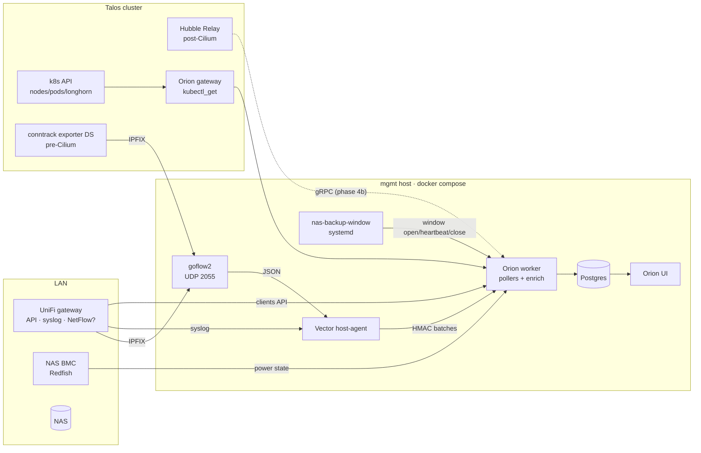

# Design: DCO network & host visibility for Orion

Status: proposal · 2026-11-28 · docs only, no code in this PR.

Goal: Orion answers "what is this device, is it up, why, and who is it talking to?" without
anyone running `talosctl` / `kubectl` / `journalctl` by hand. Addresses below are placeholders
(`10.0.0.x`, `mgmt`, `nas`, `node-0N`). They are not the real install. Figures in the "with this design" column are illustrative.

## 1. Motivating incidents → what Orion must answer

| # | Question asked | What it took by hand | With this design (clicks) |
|---|---|---|---|
| 1 | "Why is the NAS (`nas`, 10.0.0.34, normally off) on?" | Read a systemd timer on `mgmt` (10.0.0.9): `nas-backup-window` at 04:30 UTC wakes the NAS by WoL, waits for Longhorn backup jobs, then shuts it down via the NAS API. The first full weekly media backup (~16.7 TB, 3 volumes, one at a time, ~22–26 MB/s over NFS) ran for 6 days. A `mgmt` reboot killed the waiting service, so nothing was left to shut the NAS down. | Alert **"nas: planned window overdue, owner process gone"** → **1 click** opens the host page: *Up 6d (BMC: on) · planned window `nas-backup-window` opened 04:30 by `systemd@mgmt` · expected off: after Longhorn backups · owner heartbeat lost 3d ago (mgmt rebooted) · backup 2 of 3 volumes, 61 %, 24 MB/s, ETA ~3d* (backup line from phase 2). |
| 2 | "Why is MAC `02:00:00:00:00:02` uploading?" | ARP lookups to map MAC → node-02 (10.0.0.239), then sampling `/proc/net/dev` via talosctl and decoding the `cni0` bridge FDB to tie traffic to pods. Top talker: Longhorn instance-manager (replica sync, LAN). Transmission (seeding through a gluetun VPN sidecar) was small at the time. | Paste the MAC in the inventory search → host page **node-02** (click 1) → Traffic panel (click 2): *top workloads, last 15 min: `longhorn-system/instance-manager` 41 MB/s **LAN** → node-01/03 (replica sync); `media/transmission` 0.6 MB/s **WAN** → VPN endpoint.* |

## 2. What exists today (verified on `main`)

| Piece | Path | Live data source? | Note |
|---|---|---|---|
| Flows API | `apps/web/src/app/api/monitoring/security/flows/route.ts` | **No.** It proxies the gateway's `elk_flow_search`, and no Elasticsearch is deployed. | It sends `query:'*'` and `limit`, but the tool `JSON.parse`s `query` and reads `size`, so it fails even when ES is present. |
| Flows UI | `apps/web/src/components/security/FlowTable.tsx` (in `SecurityDashboard.tsx`) | No | Flat 5-tuple table. No asset, pod or LAN/WAN context. |
| ES/ntopng/Wazuh tools | `apps/gateway/src/builtin-tools/security.ts` | No (none of the three is deployed) | `ntopng_top_talkers`, `elk_flow_search`, `wazuh_*`; `prometheus_query` needs VictoriaMetrics. |
| ntopng poller | `apps/web/src/jobs/security-poll-ntopng.ts` | No | Reads `NTOPNG_URL`. The gateway tool and `lib/seed-soc-config.ts` use `NTOPNG_API`. |
| ELK poller | `apps/web/src/jobs/security-poll-elk.ts` | No | |
| K8s events poller | `apps/web/src/jobs/security-poll-k8s.ts` | Only when a cluster env has a connected gateway | Calls gateway tools per cluster env. This is the pattern to reuse. |
| Webhooks | `.../security/webhooks/{falco,crowdsec,wazuh,host-agent}/route.ts` | Falco: **yes**. The CrowdSec webhook exists, but the in-cluster CrowdSec is not wired to it | HMAC + replay window in `apps/web/src/lib/security/webhook-auth.ts`. |
| Host agent | `deploy/host-agent/vector.toml` | Built (Orion host telemetry) | journald, docker events, Vault audit, Traefik. **UDM syslog (UDP 5514) already arrives but only goes to Loki.** |
| Source health | `SourceHealth` / `EnvironmentSourceHealth` in `apps/web/prisma/schema.prisma`, `components/security/SourceHealthPanel.tsx`, `.../security/sources/route.ts` | Yes | New sources show up automatically once they write a row. |
| Events / incidents | `SecurityEvent`, `Incident`, `CorrelationRule` | Yes | Every DCO alert below is a `SecurityEvent`, so ack, incidents and notifications already work. |
| Gateway k8s read RBAC | `apps/web/src/lib/gateway-rbac.ts` | n/a | `view` plus a read ClusterRole that **already covers `nodes` and `longhorn.io` `backups`/`backupvolumes`/`volumes`/`recurringjobs`.** Phase 1 needs no RBAC change. |
| Monitoring installer | `apps/web/src/lib/bootstrap/monitoring.ts`, `deploy/monitoring/**` | n/a | Uses imperative `kubectl apply`/`helm`. It applies `ntopng/service.yaml` but **never the DaemonSet**. ES/Elastiflow only in the `full` stack. |
| Infra UI | `apps/web/src/components/infrastructure/NodeGrid.tsx` | Yes (k8s) | Nodes only. No non-k8s hosts, no MACs. |

Falco (via falcosidekick) is the only security source feeding Orion live today. Nothing collects flows, inventory or power state.

## 3. Requirements

| ID | Requirement | From | Phase |
|---|---|---|---|
| R1 | Asset inventory: MAC ↔ IP ↔ hostname ↔ kind ↔ k8s node ↔ workloads, with history (IPs get reused) | #2 | 1 |
| R2 | Alert on a new MAC, or an IP change on a static asset | DCO | 1 |
| R3 | Host up/down, plus power state from the BMC where one exists | #1 | 1 |
| R4 | Planned power windows: owner, reason, expected-off time, owner heartbeat; alerts for overdue, orphaned and unplanned-up | #1 | 1 |
| R5 | Backup-job visibility: Longhorn backup state, progress, rate, ETA, linked to the window that keeps the NAS up | #1 | 2 |
| R6 | Per-pod and per-host byte rates (who is busy) | #2 | 2 |
| R7 | Flow telemetry: src asset/pod → dst asset/name/IP, port, bytes in/out, LAN/WAN/cluster scope | #2 | 3–4 |
| R8 | DNS visibility: which client resolved what, and passive-DNS names on WAN IPs | DCO | 5 |
| R9 | IDS alerts in Orion: UDM IPS first, Suricata optional | DCO | 5 |
| R10 | Baseline/anomaly: new WAN destination per asset/workload, upload spike | DCO | 6 |
| R11 | Works on Flannel now and on Cilium/Hubble later, behind one ingestion contract | env | all |
| R12 | Every collector lands in the installer/templates, ships off by default, and shows in Source Health | owner rule | all |

## 4. Architecture



All flow sources are normalised into one `FlowBatch` (5-tuple, bytes/packets each way,
exporter, observation window). Enrichment (asset, pod, scope) happens once, in the worker.
That way, swapping the conntrack exporter for Hubble changes no storage or UI.

## 5. Data sources: options and recommendations

### 5.1 Inventory (R1, R2)
| Option | Gives | Cost | Verdict |
|---|---|---|---|
| UniFi Network API (`/stat/sta`, clients) | MAC, IP, hostname, OUI, last seen, uplink, per-client tx/rx | Read-only local account | **Primary** for L2/L3 |
| k8s API via existing gateway `kubectl_get` | Node InternalIP, pod IP → ns/pod/owner/node, hostNetwork | None (RBAC already granted) | **Primary** for the node/pod layer |
| ARP/neighbour table from `mgmt` (Vector `exec` of `ip -j neigh`) | MAC ↔ IP on the /24 | Tiny | Fallback when UniFi is unreachable |
| DHCP leases (UniFi) | Hostname hints | Comes with the UniFi API | Included |
| Talos API (`LinkStatus`) | Per-NIC MAC on nodes | New `os:reader` talosconfig plus a gateway tool (owner path) | Later. UniFi/ARP already give the node MACs |

### 5.2 Power and up state (R3, R4)
| Option | Gives | Verdict |
|---|---|---|
| TCP-connect probe from the worker (e.g. :443/:22). No raw ICMP, so no `NET_RAW` | Reachable / unreachable | **Primary** for every host |
| k8s Node `Ready` (+ Talos later) | Node health | **Primary** for nodes |
| BMC Redfish (`/redfish/v1/Systems/*` `PowerState`) | On/off even when the OS is hung | **Yes for the NAS.** Separates *off* from *hung* |
| Host-agent heartbeat | `mgmt` liveness | Already flows; reuse |
| Window reporter: the systemd unit `curl`s Orion on open, every 5 min, and on close | **Why it is up**, owner, expected-off | **Required.** Turns "up" into "up on purpose" |

The window reporter is a ~10-line change in the homelab repo, not in Orion. It reads its token
from a file (`curl -H @/run/credentials/...`), never from argv. Orion, not the systemd unit,
remembers that a window is open. A reboot therefore produces an *orphaned window* alert instead of silence.

### 5.3 In-cluster flows and pod attribution (R6, R7)
| Option | Pros | Cons | Verdict |
|---|---|---|---|
| A. cAdvisor pod network counters via VictoriaMetrics (`container_network_*_bytes_total`) | No new collector; per-pod bytes | No destinations; needs VM deployed | **Phase 2.** Answers "which pod is busy" |
| B. conntrack exporter DaemonSet (hostNetwork, `CAP_NET_ADMIN`, read-only rootfs). Prefer off-the-shelf `ulogd2` NFCT → IPFIX; fallback a ~200-line Go agent | Sees the pod IP **before** Flannel SNAT, both directions, LAN and WAN. Uses the same goflow2 collector | Needs `net.netfilter.nf_conntrack_acct=1` (Talos machine-config patch via Git); long-lived flows need periodic delta export | **Recommended pre-Cilium** |
| C. eBPF agent (e.g. Microsoft Retina, CNI-agnostic) | Packaged, pod-aware | Privileged and heavier; Talos support unverified | Fallback if B fails on Talos |
| D. Hubble (post-Cilium) via Relay gRPC | Native identity, DNS, drops, L7 | Needs Cilium; Relay mTLS | **Recommended after Cilium.** Replaces B. With kube-proxy replacement, netfilter conntrack misses pod traffic, so B must go |

Attribution: the worker joins `srcIp` against `WorkloadAddress` rows valid at that time. A
hostNetwork pod or a node IP is attributed to the node asset.

### 5.4 Network-edge flows and IDS (R7, R9)
| Option | Pros | Cons | Verdict |
|---|---|---|---|
| UniFi NetFlow/IPFIX → **goflow2** on `mgmt` | Covers every device (NAS, IoT) for routed/WAN traffic; tiny footprint | Availability depends on model/firmware (**verify**); misses same-L2 traffic (e.g. Longhorn sync) | **Recommended if available.** Otherwise use per-client UniFi counters (5.1) |
| ntopng | Already has a tool, a poller and manifests | Installer never applies the DaemonSet; env-var mismatch; one node sees only its own traffic; advanced features need a paid edition | Keep as an optional integration, not the primary |
| Zeek / Suricata on a switch mirror port | Best fidelity: DNS, TLS SNI, IDS signatures | Needs a SPAN port plus a capture NIC/host | **Defer** (phase 7, optional) |
| UDM IDS/IPS events from syslog (already reaching Vector) | IDS with no new infra | Signature quality depends on UniFi | **Recommended first IDS source** (phase 5) |

### 5.5 DNS (R8)
The cluster CoreDNS `log` plugin is enabled via Git. Vector ships those lines and the LAN
resolver's query log to the worker, which stores `DnsObservation` rows (passive DNS, so flows
can show names). After Cilium, Hubble DNS events give the querying pod. The LAN resolver
needs to be confirmed (open question 3).

### 5.6 Backups (R5)
Poll `backups.longhorn.io` and `backupvolumes` through the existing `kubectl_get` every 60 s.
Read `status.state`, `progress`, `volumeName`, `size`, `backupCreatedAt`, `messages`. The worker
derives a rate from successive progress samples and computes the ETA. A Longhorn backup whose
target is the NAS gets linked to the open window, so the window's expected-off becomes
"when the last linked backup completes".

## 6. Flow storage

Volume estimate for about 60 active LAN assets and ~150 pods. The VPN sidecar hides the torrent swarm behind one endpoint.

| Layer | Rows/day | Size/day | Retention | Size at retention |
|---|---|---|---|---|
| Raw flow records (not stored) | 0.5–3 M | 150–600 MB | – | – |
| 5-min rollup (asset/workload × dst × port × proto × scope), top 50 dsts per src per bucket, rest folded into `other` | ~60–180 k | ~15–40 MB | 30 d | ~0.5–1.2 GB |
| 1-hour rollup | ~10–20 k | ~3 MB | 365 d | ~1 GB |
| `AssetPeer` baseline (first/last seen per peer) | grows slowly | <1 MB | 180 d idle | <100 MB |

| Store | For | Against | Verdict |
|---|---|---|---|
| **Postgres (existing `pgvector/pgvector:pg16`)**, rollups only | No new service, backup or installer piece. Prisma, joins with `Asset`, retention via the existing `security-retention-daily` job | Not suited to raw per-connection forensics | **Chosen** |
| Timescale | Continuous aggregates, compression | Means swapping the production DB image; not needed at this volume | No |
| ClickHouse | Raw flows cheaply, fast aggregation | New stateful service, backup, installer, ~1 GB RAM | Escape hatch if raw forensics are ever needed |
| Elasticsearch | Manifests and tool already exist | 2–4 GB heap, not deployed, route broken | No (keep the tool for installs that already have ES) |

Adapting existing code: the flows route gets a `FlowBackend` interface. `postgres` (default)
reads `FlowRollup`. `elk` keeps today's gateway call, with the `query`/`size` mismatch fixed. The
response keeps `src_ip`/`dst_ip`/... and adds `src_asset`, `src_workload`, `dst_name`, `scope`,
`bytes_out`/`bytes_in`. `FlowTable` renders the new columns only when they are present. A new
read-only agent tool `dco_flows` (plus `dco_asset_lookup` and `dco_host_status`) queries the web
API. `elk_flow_search` stays as it is.

## 7. Data model additions (Prisma sketch)

```prisma
model Asset {             // one per physical/virtual device
  id String @id @default(uuid())
  environmentId String?   // cluster env for k8s nodes
  kind String             // host|k8s_node|nas|network|iot|unknown
  name String
  mac String? @unique
  primaryIp String?
  vendor String?          // OUI
  k8sNodeName String?
  expectedPower String @default("always_on") // always_on|scheduled|on_demand
  known Boolean @default(false)              // false → new-device alert until acked
  state String @default("unknown")           // up|down|unknown
  powerState String?                         // on|off (BMC)
  stateSince DateTime?
  probe Json?             // {tcpPort, bmcRef}: refs only, creds stay in Vault
  firstSeen DateTime @default(now())
  lastSeen DateTime?
  @@index([primaryIp])
}
model AssetAddress {      // MAC/IP/hostname history
  id String @id @default(uuid()); assetId String; kind String; value String
  source String; firstSeen DateTime; lastSeen DateTime
  @@unique([assetId, kind, value]) @@index([kind, value])
}
model WorkloadAddress {   // pod IP → workload, time-bounded for attribution
  id String @id @default(uuid()); environmentId String; ip String
  namespace String; pod String; ownerKind String?; ownerName String?
  nodeAssetId String?; hostNetwork Boolean; validFrom DateTime; validTo DateTime?
  @@index([ip, validFrom])
}
model AssetStateChange { id String @id @default(uuid()); assetId String; from String; to String; at DateTime; source String; reason String? }
model PowerWindow {       // the plan
  id String @id @default(uuid()); assetId String; name String; schedule String // cron, UTC
  ownerRef String         // e.g. "systemd:nas-backup-window@mgmt"
  maxDurationMin Int; graceMin Int @default(30); heartbeatEveryMin Int @default(5)
  linkBackups Boolean @default(false)
}
model PowerWindowRun {    // one occurrence
  id String @id @default(uuid()); windowId String; openedAt DateTime
  expectedOffAt DateTime?; lastHeartbeatAt DateTime?; closedAt DateTime?
  status String           // open|closed|overdue|orphaned|unplanned
  detail Json?            // linked backup names, close reason
}
model BackupJob {         // mirror of Longhorn Backup CRs
  id String @id @default(uuid()); environmentId String; name String; volume String
  state String; progress Int; sizeBytes BigInt?; rateBps BigInt?; etaAt DateTime?
  startedAt DateTime?; completedAt DateTime?; updatedAt DateTime @updatedAt
  @@unique([environmentId, name])
}
model FlowRollup {
  bucketStart DateTime; bucketSec Int        // 300 | 3600
  srcAssetId String?; srcWorkload String?    // "ns/owner"
  srcIp String; dstIp String; dstAssetId String?; dstName String?
  dstPort Int; proto String; scope String    // lan|wan|cluster
  bytesOut BigInt; bytesIn BigInt; packets BigInt; flows Int; exporter String
  @@id([bucketStart, bucketSec, srcIp, dstIp, dstPort, proto, exporter])
  @@index([srcAssetId, bucketStart]) @@index([scope, bucketStart])
}
model AssetPeer { subject String; peer String; port Int; firstSeen DateTime; lastSeen DateTime; bytes BigInt; @@id([subject, peer, port]) }
model DnsObservation { clientIp String; qname String; answer String; firstSeen DateTime; lastSeen DateTime; count Int; @@id([clientIp, qname, answer]) }
```
Each schema slice ships its own `tYYYYMMDDHHMMSS_<name>` migration and regenerates
`context/schema.md`. New `SourceHealth.source` values: `unifi`, `power_probe`, `bmc`,
`longhorn_backups`, `flows_edge`, `flows_cluster`, `hubble`, `dns`, `udm_ids`. LAN CIDRs (RFC 1918
plus the pod/service CIDRs) and known VPN endpoints live in `SecurityConfig` and drive `scope`.

## 8. UI surfaces

| Surface | Content | Notes |
|---|---|---|
| **Inventory** (new Infrastructure tab) | Assets table: name, kind, MAC, IP, node, state, last seen, known. Global search by MAC/IP/hostname/pod | Every row drills down to the host page |
| **Host page** `/infrastructure/hosts/[id]` | State banner (up/down, BMC power, *why up*: window, owner, expected-off, overdue). Window timeline. Linked backups (progress, rate, ETA). Traffic: top peers and top workloads, LAN/WAN split, 15 min/1 h/24 h. State history. Related `SecurityEvent`s | Incident #1 in one view, #2's answer panel |
| **Flows** (existing Security tab, `FlowTable`) | Rollup view: src asset/workload → dst asset/name, scope chip, bytes out/in. Filters by asset, scope, time; group by src/dst/workload | Same route, new backend |
| **Source Health** (existing panel) | New sources plus labels/icons | Stale → existing `source_stale` events |
| **NodeGrid** (existing) | Node card links to its host page | Small |

## 9. Alert rules (all `SecurityEvent`, deduped per asset/run)

| Type | Fires when | Sev |
|---|---|---|
| `dco.asset.new` | A MAC not seen before and not `known` | 50 |
| `dco.asset.ip_changed` | The IP of an asset tagged static changes | 30 |
| `dco.host.down` | An `always_on` asset is down > 3 min, or a node is NotReady | 60 |
| `dco.power.unplanned_up` | A `scheduled` asset is up with no open run | 60 |
| `dco.power.overdue` | Now > `expectedOffAt` + grace. The text carries backup progress/ETA | 50 |
| `dco.power.orphaned` | A run is open and its owner heartbeat is missing > 3× interval (the reboot case) | 50 |
| `dco.backup.stalled` / `.failed` | Progress unchanged 30 min / state `Error` | 50 / 60 |
| `dco.flow.new_destination` | A WAN peer (IP, /24 or domain) not in `AssetPeer` for 14 d and > 1 MB | 30 (60 for `mgmt`/nodes) |
| `dco.flow.upload_spike` | Hourly WAN `bytesOut` > 3× the 14-day p95 for that asset/workload | 40 |
| `udm_ids.*` | UDM IPS syslog line, normalised | per signature |

## 10. Security of the pipeline

| Component | Runs as | Access | Credentials and where they live |
|---|---|---|---|
| Inventory/backup poller | Orion worker → existing gateway | k8s `view` + read ClusterRole (no Secrets, no exec, no writes) | Existing gateway token |
| UniFi poller | Orion worker | Dedicated local UniFi account with the **View Only** role | Vault KV, read via `vaultFetch` in `apps/web/src/lib/vault.ts`. Never stored in `SecurityConfig` plaintext, env, argv or logs |
| BMC poller | Orion worker | Redfish read-only operator account; GET only | Vault KV |
| goflow2 | compose service, non-root, read-only rootfs, `cap_drop: ALL`, UDP 2055 bound to the LAN interface | Receives flows only; does not need to be reachable from the internet | None |
| Vector → Orion | existing host agent | HMAC-signed batches with a replay window (`webhook-auth.ts`) | `FLOW_WEBHOOK_SECRET` generated by `deploy/bootstrap.sh` like `HOST_AGENT_WEBHOOK_SECRET` |
| conntrack exporter | DaemonSet: hostNetwork, `CAP_NET_ADMIN` only, non-root where possible, read-only rootfs, own namespace labelled PSA `privileged` | Read-only conntrack netlink; no k8s API token (`automountServiceAccountToken: false`) | None. It only emits IPFIX |
| Hubble consumer | Orion worker | Relay read-only gRPC | Relay client cert from Vault via ExternalSecret |
| Talos reader (later) | gateway tool | `os:reader` role only, no `talos_*` write tools for DCO | talosconfig in Vault, passed as a temp file (never argv), as `builtin-tools/talos.ts` does today |
| Window reporter | systemd unit on `mgmt` | POST to one endpoint, scoped token | Token in a root-only file / systemd credential, passed via `curl -H @file` |

Webhook routes return 401 without a valid HMAC. Flannel ignores NetworkPolicy, so the
exporter's isolation relies on it having no listener and no token. Cluster changes (DaemonSet,
sysctl patch, CoreDNS `log`) go through the cluster's Gitea GitOps repo and ArgoCD, never `kubectl apply`.

## 11. Installer / templates

| Piece | Lands in | Fresh install gets |
|---|---|---|
| goflow2 | `deploy/docker-compose.yml` service under a `dco` profile, plus a Vector source/sink in `deploy/host-agent/vector.toml` | Started when the profile is enabled. Secret generated by `deploy/bootstrap.sh` |
| conntrack exporter | new `deploy/monitoring/dco/conntrack-exporter.yaml`, written into the env GitOps repo by `apps/web/src/lib/bootstrap/` (layout of `deploy/env-scaffold/k8s`). `monitoring.ts` applies it only for non-GitOps envs | Opt-in toggle on the cluster env |
| Talos sysctl patch | Documented machine-config patch in the env repo | Opt-in |
| UniFi / BMC / power windows | Settings → Security → Sources form, which writes creds to Vault | Empty, with a "not configured" row in Source Health |
| Pollers and alert rules | `apps/web/src/worker/scheduler.ts` entries (no-op when unconfigured) and `lib/seed-correlation-rules.ts` | Always present, idle until configured |

## 12. Phased rollout (each slice < ~300 lines, including tests)

| # | Slice | Delivers | Depends on |
|---|---|---|---|
| 1a | Schema: `Asset`, `AssetAddress`, `AssetStateChange`, `PowerWindow`, `PowerWindowRun` + migration | Foundation | – |
| 1b | Inventory sync job: k8s nodes/pods via `kubectl_get` and UniFi clients; `dco.asset.new` | R1, R2 (no Cilium) | 1a |
| 1c | Power probe (TCP + Redfish) + window endpoint (HMAC) + overdue/orphaned/unplanned rules | **Incident #1 alert** | 1a |
| 1d | Inventory tab + host page (state, window, history) | **Incident #1 in 1 click, MAC lookup** | 1b, 1c |
| 1e | Homelab repo (outside Orion): window reporter in `nas-backup-window` | Feeds 1c | 1c |
| 2a | `BackupJob` + Longhorn poller + ETA, linked to the window | R5 | 1c |
| 2b | Host page traffic panel from cAdvisor pod counters (VictoriaMetrics) | R6, **incident #2 top talker** | 1d |
| 3a | `FlowRollup` + flow webhook + enrichment (asset/pod/scope) | R7 storage | 1b |
| 3b | goflow2 + Vector config + installer profile; UniFi IPFIX if available | R7 edge | 3a |
| 3c | Flows route `FlowBackend` + `FlowTable` columns; fix the ELK arg mismatch | R7 UI | 3a |
| 4a | conntrack exporter manifest + Talos sysctl patch (GitOps) | R7 pod destinations, **#2 LAN/WAN** | 3b |
| 4b | Hubble Relay consumer (after Cilium); retire 4a | R11 | Cilium |
| 5 | UDM IPS syslog → `udm_ids` events; CoreDNS/LAN DNS → `DnsObservation` | R8, R9 | 3a |
| 6 | `AssetPeer` baseline + new-destination/upload-spike rules | R10 | 3a |
| 7 | Optional: Suricata/Zeek on a mirror port; read-only `dco_*` agent tools (owner path) | depth | 5 |

Phases 1–2 need neither flows nor Cilium, and together cover both incidents' first questions.

## 13. Open questions for the owner

1. Does the installed UniFi gateway/firmware offer NetFlow/IPFIX export? If not, are per-client counters plus a later mirror port acceptable?
2. Is VictoriaMetrics (with cAdvisor scraping) running in the cluster? Slice 2b depends on it.
3. What is the LAN DNS resolver (UDM, Orion's CoreDNS, something else), and can it export query logs?
4. Should Orion only *observe* the NAS window, or should it later *own* the shutdown (approval-gated action) when the linked backups finish?
5. Does the NAS BMC expose Redfish, or only IPMI? IPMI would need an `ipmitool`-capable poller.
6. Is a custom ~200-line conntrack agent acceptable, or must 4a be off-the-shelf only (ulogd2/Retina)?
7. Flow retention: is 30 d at 5 min and 1 y hourly enough, or is raw-flow forensics wanted (→ ClickHouse)?
8. Which assets are deliberately off part of the time, besides the NAS? Is there a target timeline for the Cilium migration?
